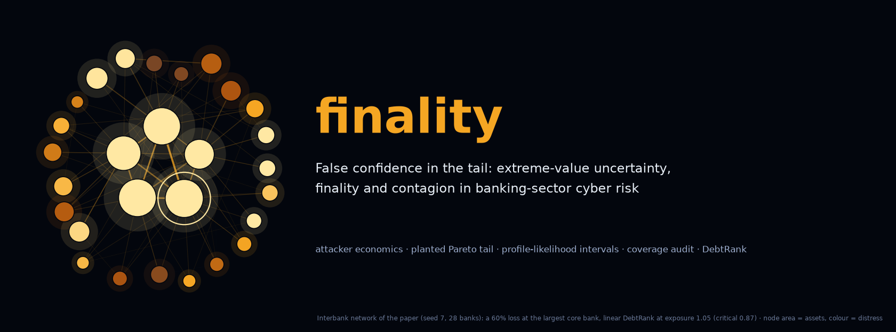

<p align="center"><a href="paper/paper.pdf"></a></p>

<p align="center">
<a href="https://github.com/thanatchon36/finality-research/actions/workflows/ci.yml"></a>
<a href="pyproject.toml"></a>
<a href="https://thanatchon36.github.io/finality-research/paper/"></a>
<a href="paper/paper.pdf"></a>
<a href="https://thanatchon36.github.io/finality-research/instrument/"></a>
<a href="#scope"></a>
<a href="https://huggingface.co/datasets/thanatchon36/finality-research"></a>
<a href="LICENSE"></a>
<a href="https://zenodo.org/badge/latestdoi/1450099996"></a>
</p>

<p align="center">
📖 <b><a href="https://thanatchon36.github.io/finality-research/paper/">Read the paper online</a></b> ·
📄 <b><a href="paper/paper.pdf">Download the PDF</a></b> ·
🎛️ <b><a href="https://thanatchon36.github.io/finality-research/instrument/">Interactive instrument</a></b> ·
📊 <b><a href="results/results.md">Results</a></b> ·
🤗 <b><a href="https://huggingface.co/datasets/thanatchon36/finality-research">Dataset</a></b> ·
📝 <b><a href="CHANGELOG.md">Changelog</a></b>
</p>

**Finality, extreme-value uncertainty and contagion in banking-sector cyber risk.** Why do rational attackers
prefer venues that hold less money? How confidently can one state the return period of a catastrophic
banking-sector loss from a few decades of data? And how does one large loss spread through interbank exposures?
The code audits peaks-over-threshold intervals against a planted truth, decomposes attacker payoffs exactly, and
propagates losses with linear DebtRank.

[](https://thanatchon36.github.io/finality-research/instrument/)

> <a id="scope"></a>**Scope.** Defensive, actuarial and policy research. The models describe attacker incentives
> and aggregate losses only; the repository contains no attack technique. **All parameters are illustrative**:
> recalibrate with real data before citing any number. "When" is always a probabilistic return period, never a date.

## What the paper finds

| Record length | Delta method | Parametric bootstrap | Profile likelihood |
|---|---:|---:|---:|
| 30 years, loss pipeline | 60.2% | 62.3% | **82.9%** |
| 100 years, loss pipeline | 80.6% | 81.6% | **92.1%** |
| 30 years, exact GPD | 71.3% | 72.8% | **90.4%** |
| 300 years, exact GPD | 92.1% | 91.2% | **94.4%** |

*Coverage of nominal 95% intervals for the 1-in-1,000-year loss; 1,000 independent records per cell.*

- **Standard intervals are overconfident in the dangerous direction.** From 30-year records they miss the
  true 1-in-1,000-year loss about 40% of the time, and every miss understates the loss: the median point
  estimate is only 0.33 times the truth.
- **Profile-likelihood intervals repair most of the damage.** They restore most of the coverage and roughly
  halve the proper interval score of Gneiting and Raftery (2007), at the price of honest width.
- **Finality drives attacker economics.** Transaction finality explains 67% of the payoff gap between a bank
  core and a cross-chain bridge; the bank becomes worth attacking only below a 0.625 recovery probability.
- **Contagion has a phase transition.** A linear DebtRank network turns explosive where the spectral radius
  of the exposure matrix crosses one (0.87 times equity), and systemic importance tracks interconnection,
  not size.

## Install and quickstart

```bash
make setup      # uv venv + dependencies (Python 3.12)
make test       # 19 unit tests, about 1 s
make quick      # 15-second smoke run of the study   (writes results-quick/)
make study      # full Monte Carlo study, ~5 min     (resumable; every finished cell is cached)
make paper      # tables, figures and paper/paper.pdf (needs TeX Live)
```

Without uv: `pip install -e ".[dev,paper]"`, then `python -m pytest -q` and `python run_study.py`.
`python run_study.py --budget 60` splits the full study into resumable chunks.

| Target | Purpose |
|---|---|
| `setup` | Create `.venv` with uv and install the package with its test and paper extras |
| `test` | 19 unit tests, including a bit-exact check of the network generator against the web instrument |
| `quick` | Smoke run of the whole study in about 15 seconds → `results-quick/` |
| `study` | Full Monte Carlo study from master seed 20261108 → `results/` (JSON, Markdown, figures, interval cache) |
| `figures` | Wilson intervals, McNemar tests and interval scores → `paper/tables/`; vector figures with an overlap check → `paper/figures/` |
| `paper` | `figures`, then `paper/paper.pdf` (latexmk + pdfLaTeX) |
| `web` | Web reader → `docs/paper/index.html`, served at <https://thanatchon36.github.io/finality-research/paper/> (pandoc) |
| `banner` | README banner → `docs/assets/banner.png`, drawn from the paper's interbank network |
| `poster` | LinkedIn poster → `docs/assets/linkedin_poster.png`, with real intervals from the coverage study |
| `hf` | Hugging Face dataset → `hf/`, regenerated from the seeds and checked against `results/`; `hf-upload` publishes it |
| `arxiv` | arXiv source archive with the `.bbl` included → `paper/arxiv-source.zip` |

## What the code does

1. **Attacker incentives** (`finality.attacker`): a rational-choice model of venue selection. Retained value is a
   product of breach probability, value, finality and laundering haircut, so the log payoff gap between two
   venues splits exactly into four shares, with no ordering problem.
2. **Loss process** (`finality.lda`): Poisson frequency, a log-normal body, a planted Pareto tail and cascades.
   The planted tail index gives a known truth, computed from two million simulated years, against which every
   tail estimate is audited.
3. **Tail inference** (`finality.evt`): peaks-over-threshold GPD fits by maximum likelihood, with delta-method,
   parametric-bootstrap and profile-likelihood intervals for return levels, and a second-order compound-sum
   correction from incident-level to annual-aggregate return levels.
4. **Coverage audit** (`finality.coverage`, `run_study.py`): 1,000 independent records per design cell; every
   interval of every record is cached in `results/cache/`, so any cell can be resumed and audited record by record.
5. **Contagion** (`finality.contagion`): a core-periphery interbank network, linear DebtRank, its spectral
   stability condition and a systemic-importance ranking.
6. **Paper** (`paper/`): `analysis.py` turns the results into tables and number macros, so no number in the text
   is typed by hand; `make_figures.py` replays the study's seeds, asserts that it reproduces the stored estimates
   and checks every figure for overlapping text.

## Research: *False Confidence in the Tail: Finality, Extreme-Value Uncertainty, and Contagion in Banking-Sector Cyber Risk*

The preprint by Thanatchon Chongmankhong (November 2026) is in [`paper/`](paper/): a PDF in
[`paper/paper.pdf`](paper/paper.pdf), its LaTeX source in [`paper/paper.tex`](paper/paper.tex) and
[`paper/sections/`](paper/sections/), and a web version at
<https://thanatchon36.github.io/finality-research/paper/> built from the same source and the same number macros.
`make arxiv` packs the source with its figures and the generated `.bbl` for arXiv.

- Tables: [`paper/tables/`](paper/tables/) · Figures: [`paper/figures/`](paper/figures/) · Results: [`results/`](results/)
- Dataset on Hugging Face: [`thanatchon36/finality-research`](https://huggingface.co/datasets/thanatchon36/finality-research), with all
  36,000 interval estimates of the coverage study scored against the truth, 200,000 simulated years of losses, the true
  return-level curve, the two single records, the attacker venues and the interbank network with its cascades (all simulated)
- Interactive instrument: [`docs/instrument/`](docs/instrument/index.html), the attacker, loss, extreme-value and
  contagion models in the browser, served at <https://thanatchon36.github.io/finality-research/instrument/>

<p align="center"></p>

## Repository layout

```
src/finality/
  attacker.py           rational-choice venue selection; exact log-gap decomposition
  lda.py                loss-distribution Monte Carlo (Poisson, log-normal body, Pareto tail, cascades)
  evt.py                peaks-over-threshold GPD: MLE; delta, profile-likelihood and bootstrap intervals
  contagion.py          interbank network, linear DebtRank, spectral stability, systemic ranking
  coverage.py           Monte Carlo coverage study with a per-record cache
  plots.py              quick-look figures for results/
run_study.py            reproduces every result from master seed 20261108
results/                results.json, results.md, quick-look figures, per-record interval cache
paper/                  paper.tex, sections/, refs.bib, tables/ and figures/ (generated), paper.pdf
  analysis.py           Wilson intervals, McNemar tests, interval scores -> tables and number macros
  make_figures.py       vector figures; replays the study's seeds and checks every figure for overlaps
  figlint.py            fails if any text touches other text, lines, markers or bars
  pagecheck.py          page-fill audit of the compiled PDF
  reader.html           pandoc template of the web reader
scripts/
  paper_web.py          web reader: paper.tex -> docs/paper/index.html
  make_banner.py        README banner from the paper's interbank network
  make_poster.py        LinkedIn poster from the coverage study
  make_arxiv.sh         arXiv source archive
  export_hf.py          Hugging Face dataset (card: hf_README.md)
docs/                   GitHub Pages: paper/ (web reader), instrument/ (FINALITY), assets/
tests/                  attacker and loss models, EVT, contagion
```

## Using real data

```python
from finality.evt import fit_pot, rl_ci_profile, return_level

model = fit_pot(incident_losses, record_years=25, u_quantile=0.90, annual=annual_losses)
print(return_level(model, 1000), rl_ci_profile(model, 1000))
```

## Limitations
Illustrative calibration throughout; stationarity of the loss process; residual undercoverage with about 15
exceedances; threshold choice; and the full loss pass-through of linear DebtRank. See paper §7.

## Notes
The simulation code, a first draft of the text and the figures were prepared with the assistance of an AI system
(Claude, Anthropic). The author is responsible for the content, including the verification of every reference in
`paper/refs.bib`.

## Citation
See [`CITATION.cff`](CITATION.cff) (GitHub's **Cite this repository** button); each release is archived on Zenodo
([10.5281/zenodo.24050729](https://doi.org/10.5281/zenodo.24050729), DOI badge above). License: MIT.

```bibtex
@misc{chongmankhong2026false,
  author = {Chongmankhong, Thanatchon},
  title  = {False Confidence in the Tail: Finality, Extreme-Value Uncertainty,
            and Contagion in Banking-Sector Cyber Risk},
  year   = {2026},
  note   = {Preprint},
  doi    = {10.5281/zenodo.24050729},
  url    = {https://thanatchon36.github.io/finality-research/paper/}
}
```
