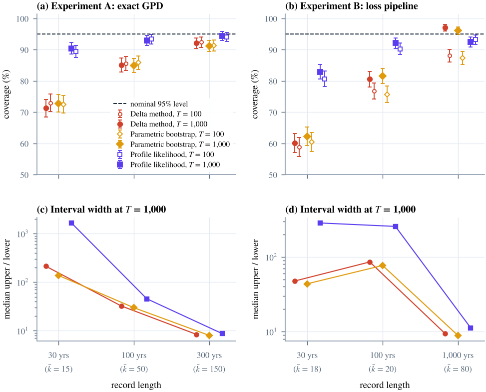

# False Confidence in the Tail

**Finality, extreme-value uncertainty, and contagion in banking-sector cyber risk**

Code, data and LaTeX source for the preprint by **Thanatchon Chongmankhong** (November 2026).
Read the paper: [`paper/paper.pdf`](paper/paper.pdf).

> **Scope.** Defensive, actuarial and policy research. The models describe attacker incentives and aggregate
> losses only; the repository contains no attack technique. **All parameters are illustrative**: recalibrate
> with real data before citing any number. "When" is always a probabilistic return period, never a date.

## What the paper finds



| Record length | Delta method | Parametric bootstrap | Profile likelihood |
|---|---:|---:|---:|
| 30 years, loss pipeline | 60.2% | 62.3% | **82.9%** |
| 100 years, loss pipeline | 80.6% | 81.6% | **92.1%** |
| 30 years, exact GPD | 71.3% | 72.8% | **90.4%** |
| 300 years, exact GPD | 92.1% | 91.2% | **94.4%** |

*Coverage of nominal 95% intervals for the 1-in-1,000-year loss; 1,000 independent records per cell.*

- **Standard intervals are overconfident in the dangerous direction.** From 30-year records they miss the
  true 1-in-1,000-year loss about 40% of the time, and every miss understates the loss: the median point
  estimate is only 0.33 times the truth.
- **Profile-likelihood intervals repair most of the damage.** They restore most of the coverage and roughly
  halve the proper interval score of Gneiting and Raftery (2007), at the price of honest width.
- **Finality drives attacker economics.** Transaction finality explains 67% of the payoff gap between a bank
  core and a cross-chain bridge; the bank becomes worth attacking only below a 0.625 recovery probability.
- **Contagion has a phase transition.** A linear DebtRank network turns explosive where the spectral radius
  of the exposure matrix crosses one (0.87 times equity), and systemic importance tracks interconnection,
  not size.

## Quick start

Requires Python 3.10 or later; building the paper also needs a TeX Live installation.

```bash
pip install -r requirements.txt
make test      # 19 unit tests, about 1 s           (or: python -m pytest -q)
make quick     # 15-second smoke run of the study   (writes results-quick/)
make study     # full Monte Carlo study, ~5 min     (or: python run_study.py)
make paper     # tables, figures and paper/paper.pdf
make arxiv     # arXiv-ready source archive, .bbl included
```

`python run_study.py --budget 60` splits the full study into resumable chunks; every finished cell is cached.

## Repository layout

```
finality/             Python package
  attacker.py         rational-choice venue selection; exact log-gap decomposition
  lda.py              loss-distribution Monte Carlo (Poisson, log-normal body, Pareto tail, cascades)
  evt.py              peaks-over-threshold GPD: MLE; delta, profile-likelihood and bootstrap intervals
  contagion.py        interbank network, linear DebtRank, spectral stability, systemic ranking
  coverage.py         Monte Carlo coverage study with a per-record cache
  plots.py            quick-look figures for results/
tests/                19 unit tests
run_study.py          reproduces every result from master seed 20261108
results/              results.json, results.md, quick-look figures, per-record interval cache
paper/                LaTeX source, generated tables and figures, compiled paper.pdf
  analysis.py         Wilson intervals, McNemar tests, interval scores -> tables and number macros
  make_figures.py     vector figures; replays the study's seeds and checks every figure for overlaps
  figlint.py          automated checker: fails if any text touches other text, lines, markers or bars
  pagecheck.py        page-fill audit of the compiled PDF
  make_arxiv.sh       builds the arXiv source archive
docs/index.html       FINALITY, the interactive browser version of the models
```

## Reproducibility

- Every number in the paper is generated into `paper/tables/numbers.tex`; nothing is typed by hand.
- `paper/make_figures.py` asserts that it reproduces the stored estimates exactly before drawing.
- The network generator is a bit-exact port of the web instrument's random number generator, and a test
  pins the instrument's published numbers, so the JavaScript and Python implementations agree.
- `results/cache/` stores every interval of every simulated record, so any coverage cell can be audited.

## Interactive instrument

`docs/index.html` runs the attacker, loss, extreme-value and contagion models in the browser. To publish it,
open **Settings → Pages**, choose **Deploy from a branch**, then select the `main` branch and the `/docs` folder.

## Using real data

```python
from finality.evt import fit_pot, rl_ci_profile, return_level

model = fit_pot(incident_losses, record_years=25, u_quantile=0.90, annual=annual_losses)
print(return_level(model, 1000), rl_ci_profile(model, 1000))
```

## Citation

GitHub shows a **Cite this repository** button generated from [`CITATION.cff`](CITATION.cff). In BibTeX:

```bibtex
@misc{chongmankhong2026false,
  author = {Chongmankhong, Thanatchon},
  title  = {False Confidence in the Tail: Finality, Extreme-Value Uncertainty,
            and Contagion in Banking-Sector Cyber Risk},
  year   = {2026},
  note   = {Preprint}
}
```

## Notes

- The simulation code, a first draft of the text and the figures were prepared with the assistance of an AI
  system (Claude, Anthropic). The author is responsible for the content, including the verification of every
  reference in `paper/refs.bib`.
- Limitations are set out in Section 7 of the paper: illustrative calibration, stationarity, residual
  undercoverage with about 15 exceedances, threshold choice, and the full loss pass-through of linear DebtRank.
